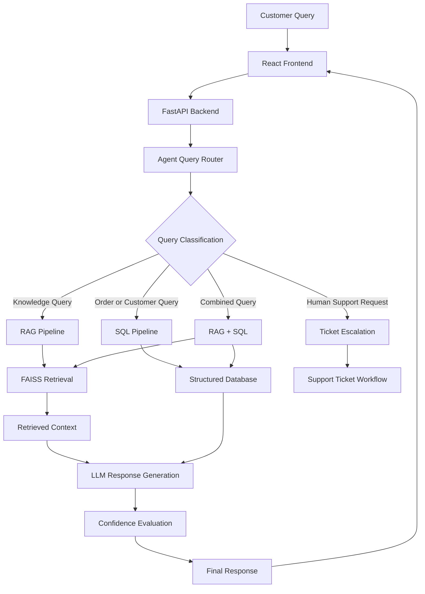

# AI Customer Support System using RAG

An AI-powered customer support application that uses **Retrieval-Augmented Generation (RAG)** to answer customer queries using a knowledge base, product information, and structured customer data.

The system combines semantic document retrieval, large language model response generation, SQL-based data access, query routing, response confidence evaluation, and customer support escalation.

## 1. Project Overview

Traditional customer support systems often depend on predefined responses and manual assistance. This project explores how Artificial Intelligence and Retrieval-Augmented Generation can improve customer support by providing relevant, context-aware answers.

The system processes customer queries, identifies the type of information required, retrieves relevant knowledge-base content or structured data, and generates an answer using an LLM.

## 2. Key Features

- AI-powered customer conversations.
- Retrieval-Augmented Generation (RAG).
- Semantic document search using vector embeddings.
- FAISS-based vector storage and similarity retrieval.
- Hybrid retrieval experiments.
- Product information retrieval.
- SQL-based customer and order information retrieval.
- Query classification and routing.
- Response confidence calculation.
- Human support escalation logic.
- Customer support ticket API structure.
- Retrieval and response-quality evaluation.
- Automated testing using Pytest.

## 3. Technology Stack

| Component | Technology |
|---|---|
| Programming language | Python 3.11 |
| Backend framework | FastAPI |
| API server | Uvicorn |
| Frontend | React |
| Frontend build tool | Vite |
| LLM provider | Groq |
| Embedding model | BAAI/bge-base-en-v1.5 |
| Vector database | FAISS |
| Document processing | LangChain |
| Database integration | SQLAlchemy |
| Database | PostgreSQL |
| Testing | Pytest |

## 4. Project Architecture

The application follows a RAG-based architecture with separate components for query routing, document retrieval, SQL retrieval, response generation, and escalation.



## 5. Actual Project Structure

```text
AI-Customer-Support-System-RAG/
│
├── README.md
├── requirements.txt
├── main.py
├── benchmark_api.py
├── check_retrieval.py
├── .gitignore
│
├── ai/
│   ├── llm/
│   │   └── llm.py
│   │
│   ├── rag/
│   │   ├── embeddings.py
│   │   ├── chunker.py
│   │   ├── pipeline.py
│   │   ├── vector_store.py
│   │   ├── loader.py
│   │   ├── retriever.py
│   │   ├── retriever_before_reranking.py
│   │   ├── hybrid_retriever.py
│   │   ├── product_retriever_experiment.py
│   │   └── reranker_experiment.py
│   │
│   ├── sql/
│   │   ├── database.py
│   │   ├── pipeline.py
│   │   ├── sql_tools.py
│   │   └── queries.py
│   │
│   ├── agent/
│   │   ├── state.py
│   │   ├── router.py
│   │   └── prompts.py
│   │
│   ├── ticket/
│   │   ├── escalation.py
│   │   └── ticket_service.py
│   │
│   └── verification/
│       └── confidence.py
│
├── backend/
│   ├── models/
│   ├── routes/
│   ├── schemas/
│   └── services/
│
├── database/
│   ├── schema.sql
│   ├── seed.sql
│   └── seed_database.py
│
├── data/
│   ├── knowledge_base/
│   │   └── policies/
│   ├── structured_data/
│   └── evaluation/
│
├── evaluation/
│   ├── results/
│   ├── scripts/
│   └── reference_answers.json
│
├── frontend/
│   └── react-app/
│       ├── public/
│       ├── src/
│       ├── index.html
│       ├── package.json
│       └── vite.config.js
│
└── tests/
    ├── test_rag.py
    ├── test_embeddings.py
    ├── test_loader.py
    ├── test_retriever.py
    ├── test_pipeline.py
    ├── test_chunker.py
    ├── test_vector_store.py
    ├── test_router.py
    └── other integration and evaluation tests
```

## 6. Main Modules

### AI Module (`ai/`)

Contains the core AI functionality.

- **LLM:** Communicates with the Groq API for response generation.
- **RAG:** Handles document loading, chunking, embeddings, vector storage, and retrieval.
- **SQL:** Handles structured database queries and retrieval.
- **Agent:** Maintains query state, routing, and prompts.
- **Ticket:** Contains escalation logic and ticket-service structure.
- **Verification:** Calculates response confidence.

### Backend Module (`backend/`)

Organizes the API application into:

- Models
- Routes
- Request and response schemas
- Services

### Database Module (`database/`)

Contains the database schema and sample data-seeding script.

### Data Module (`data/`)

Stores the information used by the application:

- Knowledge-base policies.
- Structured customer and order datasets.
- Evaluation queries.

### Evaluation Module (`evaluation/`)

Contains evaluation scripts, reference answers, and recorded results for retrieval, routing, escalation, and response-quality experiments.

### Frontend Module (`frontend/`)

Contains the React application developed using Vite.

### Tests Module (`tests/`)

Contains unit tests and integration tests for the application's AI, RAG, SQL, routing, and escalation components.

## 7. RAG Workflow

1. A customer submits a question through the frontend.
2. The FastAPI backend receives the query.
3. The agent router identifies the query category.
4. For knowledge-base questions, the RAG pipeline loads and processes documents.
5. The embedding model converts the query into a vector.
6. FAISS retrieves relevant document chunks.
7. The retrieved context is passed to the language model.
8. For structured queries, the SQL pipeline retrieves relevant database information.
9. The response is generated and its confidence is evaluated.
10. Requests requiring human assistance can be directed to the escalation workflow.

## 8. Knowledge Base and Sample Data

The project includes sample electronics marketplace information.

Knowledge-base content includes:

- Return policy.
- Refund policy.
- Shipping policy.
- Cancellation policy.
- Exchange policy.
- Payment policy.
- Warranty policy.
- Damaged product policy.

Structured data includes:

- Customers.
- Products.
- Orders.
- Order items.
- Support tickets.
- Ticket messages.

The datasets are intended for academic demonstration and testing.

## 9. Installation and Setup

### Prerequisites

- Python 3.11
- Node.js and npm
- PostgreSQL
- Git
- Groq API key

### Step 1: Clone the Repository

```bash
git clone https://github.com/Arin-12/AI-Customer-Support-System-RAG.git
cd AI-Customer-Support-System-RAG
```

### Step 2: Create a Python Virtual Environment

```bash
python -m venv ai_rag_env
```

Activate on Windows:

```powershell
.\ai_rag_env\Scripts\Activate.ps1
```

### Step 3: Install Python Dependencies

```bash
pip install -r requirements.txt
```

### Step 4: Configure Environment Variables

Create a `.env` file in the project root.

```env
GROQ_API_KEY=your_groq_api_key
DATABASE_URL=your_postgresql_connection_string
GROQ_MODEL=openai/gpt-oss-120b
```

Replace the placeholder values with your own configuration.

**Important:** Never upload your `.env` file or API keys to GitHub.

### Step 5: Configure the Database

Create the PostgreSQL database and configure `DATABASE_URL` in your `.env` file.

Use the database schema and seed scripts provided in the `database/` directory. The CSV datasets are available in `data/structured_data/`.

### Step 6: Start the Backend

From the project root:

```bash
uvicorn main:app --reload
```

Backend URL:

```text
http://127.0.0.1:8000
```

FastAPI API documentation:

```text
http://127.0.0.1:8000/docs
```

### Step 7: Start the Frontend

Open another terminal:

```bash
cd frontend/react-app
npm install
npm run dev
```

Open the local URL provided by Vite, usually:

```text
http://localhost:5173
```

## 10. Sample Customer Queries

The following questions can be used to demonstrate the system:

1. What is your return policy?
2. My phone arrived damaged. What should I do?
3. How long does it take to receive a refund?
4. Can I cancel my order?
5. Where is my order ORD1001?
6. What are the specifications of the MacBook Air M2?
7. I want to talk to a human support agent.

## 11. Evaluation Results

The project includes multiple evaluation experiments.

### Retrieval Evaluation

| Metric | Recorded Result |
|---|---:|
| Precision@5 | 54.17% |
| Recall@5 | 100% |
| MRR@5 | 100% |
| Hit Rate@5 | 100% |
| NDCG@5 | 97.11% |

### Additional Retrieval Experiment

| Method | MRR@20 |
|---|---:|
| Plain FAISS | 41.96% |
| FAISS + Topic Reranking | 55.29% |
| Current Retriever | 55.43% |

### Response Quality Evaluation

| Metric | Recorded Result |
|---|---:|
| BLEU | 0.0124 |
| ROUGE-1 F1 | 0.2693 |
| ROUGE-2 F1 | 0.1111 |
| ROUGE-L F1 | 0.2020 |

### Test Results

The recorded test execution reported:

- 136 tests passed.
- 2 warnings.

Run the test suite:

```bash
pytest
```

**Evaluation note:** Results come from different experiments and evaluation datasets. They should not be interpreted as measurements from one common benchmark. Some routing, escalation, and verification results use small labelled test sets.


## 12. Project Demonstration

**Demo Video:** Add your project demonstration video link here.

Suggested demonstration flow:

1. Launch the backend and frontend.
2. Submit a customer support query.
3. Demonstrate policy retrieval using RAG.
4. Demonstrate product information retrieval.
5. Demonstrate an order-related query.
6. Demonstrate human support escalation.

## 13. Limitations

- Response quality depends on the quality and coverage of the knowledge base.
- LLM-generated responses may occasionally be inaccurate.
- Retrieval evaluation uses a limited labelled dataset.
- Sample customer and order records are used for demonstration.
- Production deployment requires additional security, monitoring, and database configuration.

## 14. Future Enhancements

- Cloud deployment.
- Improved retrieval and reranking techniques.
- Multilingual customer support.
- Conversation history.
- Authentication and role-based access control.
- Advanced analytics dashboard.
- Integration with real customer support platforms.

## 15. Conclusion

The AI Customer Support System demonstrates the use of Retrieval-Augmented Generation to build an intelligent customer support assistant. By combining semantic document retrieval, LLM-based response generation, structured SQL retrieval, query routing, and escalation logic, the project provides a foundation for context-aware and AI-powered customer support.
